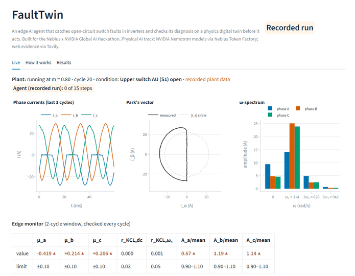
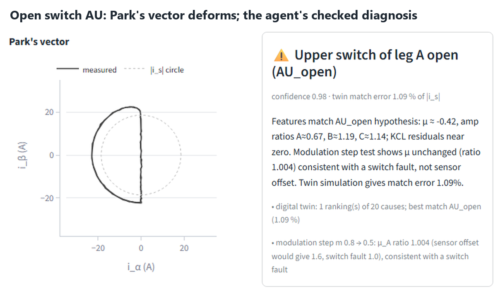
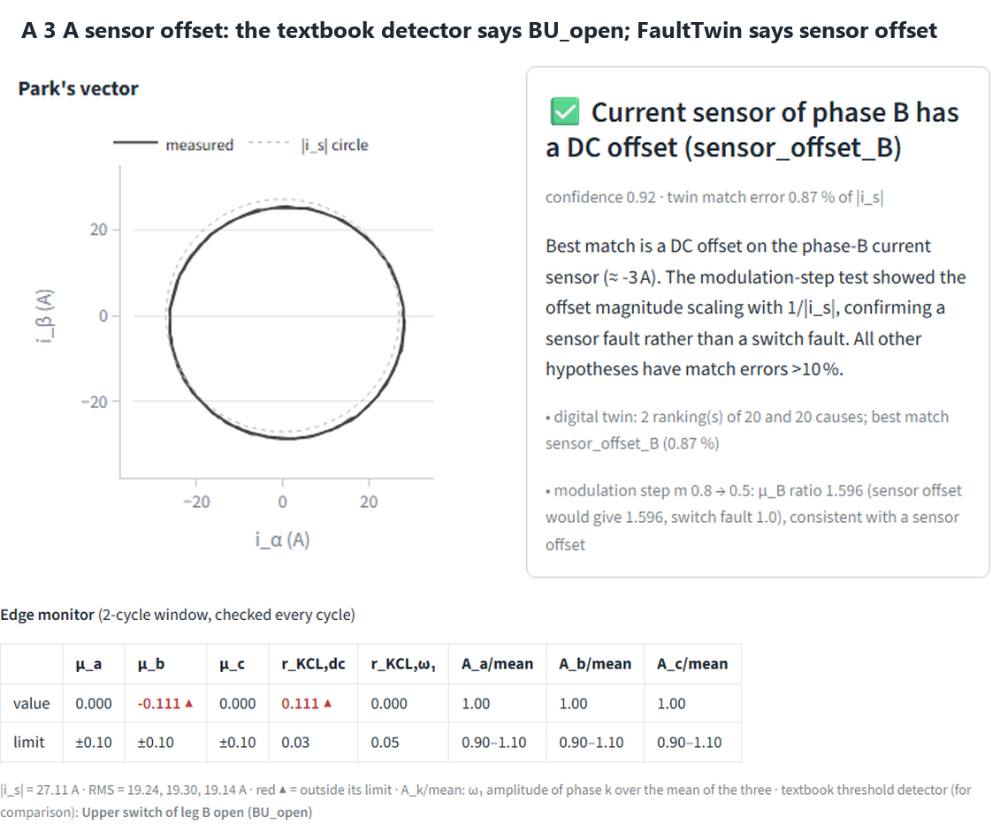
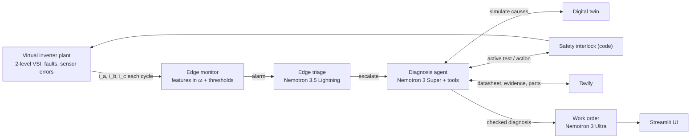
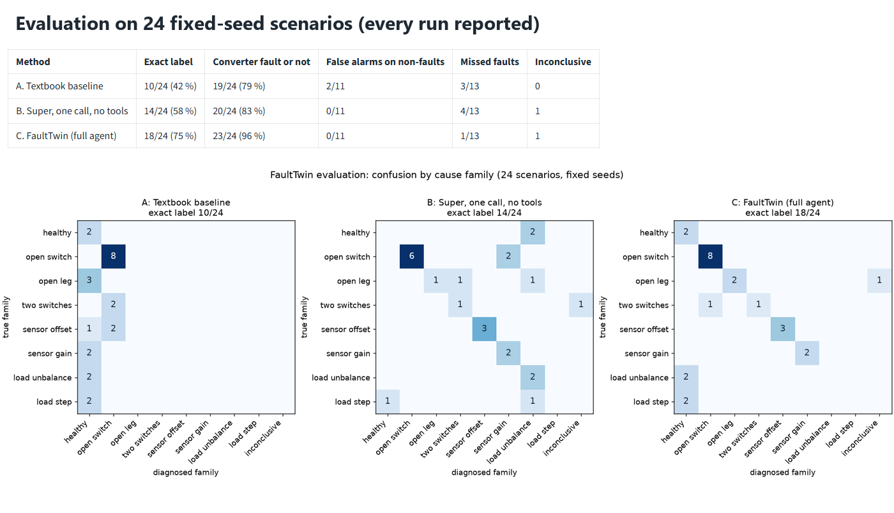

# FaultTwin

**An edge AI agent that catches open-circuit switch faults in inverters and checks its diagnosis on a physics
digital twin before it acts.**

[](LICENSE)
· **Live demo:** [faulttwin.streamlit.app](https://faulttwin.streamlit.app/) · **Video:** _link added at submission_

Built for the Nebius x NVIDIA Global AI Hackathon — Physical AI track.



## The problem

Inverters drive solar plants, EV motors, industrial drives and air-conditioning compressors. When one power switch
stops conducting (a failed gate drive, a lifted bond wire), protection usually does **not** trip: the drive keeps
running with distorted currents and stresses the other parts until a bigger failure. In an industry survey, power
semiconductor devices ranked as the most fragile converter components, and respondents asked for better
reliability monitoring (S. Yang et al., "An industry-based survey of reliability in power electronic converters,"
*IEEE Trans. Ind. Appl.*, vol. 47, no. 3, pp. 1441–1451, 2011, doi:10.1109/TIA.2011.2124436).

Simple threshold detectors catch the textbook fault, but look-alikes fool them: a current-sensor offset, a sensor
gain error, an unbalanced load, a load step. A technician would run a quick test to tell them apart. FaultTwin's
agent does that test itself, safely, and only then acts.

## What FaultTwin does

A simulated three-phase inverter runs live in the web app (simulated on the server, shown in the browser). You
inject a fault or a look-alike, or press **Mystery fault**:

1. The **edge monitor** (deterministic, every fundamental cycle) computes normalized mean currents, KCL residuals and
   an ω-spectrum in rad/s, and raises an alarm.
2. **Edge triage** (Nemotron 3.5 Lightning) classifies the alarm from the monitor's rule table.
3. The **diagnosis agent** (Nemotron 3 Super with tool calling) tests up to 32 causes on a **digital twin**, runs a
   **modulation-step test** on the plant to separate a sensor offset from an open switch, and pulls the IGBT
   datasheet, failure evidence and part links **through Tavily**.
4. A **safety interlock written in code** approves or rejects every test and action; with the verified datasheet
   rating it derates the drive to keep the peak current under 50 % of the module's I_C,nom.
5. **Nemotron 3 Ultra** writes the technician work order (Super writes one in parallel as a fallback; if neither text
   passes the code checks, a code template writes it from the checked diagnosis); Parts and Sources are added by code
   from Tavily results. Ultra wrote 85 of the 89 saved work orders, and a code template wrote the other 4.

Everything is on screen: phase currents, Park's vector, the ω-spectrum, the monitor's checks, the agent's steps with
model, tokens, latency and cost, the twin ranking, measured-vs-twin overlays, the interlock's verdicts, sources and
the work order. Without API keys (or when a spending cap is hit) the same interface plays **recorded diagnoses**.

| The agent at work | The look-alike a threshold detector gets wrong |
|---|---|
|  |  |

Open a recorded case directly: `?case=AU_open`, `BL_open`, `CU_open`, `leg_B_open`, `sensor_offset_A`,
`sensor_offset_B_3A`, `sensor_offset_C`, `sensor_gain_A` or `sensor_gain_B`, optionally with `&at=<seconds>`.

## How it works



- **Plant:** a switching-cycle-average model of a two-level inverter with an RL load and an isolated neutral (the
  neutral voltage follows from KCL over the conducting phases). It adds measurement noise and ±5 % R/L tolerances
  the twin does not know, so the twin's check is a real test.
- **Features:** μ_k = mean(i_k) / |i_s| (Park's vector modulus), r_KCL,dc and r_KCL,ω₁ (the true currents always sum
  to zero, so a residual points to a sensor), and single-bin spectra at 0, ω₁, 2ω₁ and 3ω₁ (rad/s).
- **Digital twin:** the same equations with nominal parameters; for each cause it fits the size of a look-alike
  (offset, gain, R factor) and scores the match against the measured waveforms and features.
- **Active test:** lowering m makes a sensor offset's μ grow with 1/|i_s|, while an open switch's μ stays the same.
  The interlock predicts the peak current of every plausible cause first and refuses unsafe steps.
- **Checks on the model:** the final answer must agree with the twin, cite only Tavily results, use only numbers from
  tool results, and name the switch correctly; code writes the tests run, the actions and the first maintenance step.

## How we use NVIDIA Nemotron

All models run on Nebius Token Factory. Numbers are measured over all 89 saved diagnoses: the 26 evaluation runs
and 9 development-seed runs (committed in `eval/results/traces/` and `eval/results/dev/traces/`), and 54 development
and recording runs kept locally (9 of them are the recordings in `data/replays/`). `python scripts/trace_stats.py`
recomputes them; on a fresh clone it reads the 35 committed traces.

| Model | Role | Why this model | Median latency (p95) | Median tokens per call (in / out) |
|---|---|---|---|---|
| `nvidia/Nemotron-3_5-Lightning` | Edge triage of each alarm (JSON schema, reasoning off) | Small and fast: about $0.00004 per alarm | 1.30 s (17.3 s) | 430 / 62 |
| `nvidia/NVIDIA-Nemotron-3-Nano-30B-A3B` | Triage fallback | Same price as Lightning; 28 of 28 in the triage study | used only when Lightning fails | — |
| `nvidia/nemotron-3-super-120b-a12b` | Diagnosis agent: tool calling, brief reasoning (`low_effort`) | Reliable tool calls: 550 calls, 4 outside the declared schema | 3.05 s (12.4 s) | 5,758 / 216 |
| `nvidia/Nemotron-3-Ultra-550b-a55b` | Technician work order, streamed, reasoning off | Largest model for the final text; Super writes in parallel as a fallback | 1.67 s (2.26 s) | 1,202 / 448 |

A full diagnosis costs a median **$0.018** of Token Factory credit, work order included (evaluation, 18 runs).

## How Nebius Token Factory helped

- **One OpenAI-compatible API, four Nemotron models.** The OpenAI Python SDK with
  `base_url=https://api.tokenfactory.nebius.com/v1/` serves every role; routing is a config entry per role, so cheap
  calls (triage) and heavy ones (agent, work order) share one client, one ledger and one retry policy.
- **Reasoning control.** `extra_body={"chat_template_kwargs": {"enable_thinking": False}}` switches reasoning off on
  Lightning, Nano and Super; `low_effort: True` gives Super brief reasoning. The reasoning text arrives in
  `reasoning_content` (or `reasoning` on Nano); we keep it in the trace, collapsed in the UI.
- **Structured output and tool calling** worked: JSON schema for triage, method B of the evaluation (24/24 valid) and
  datasheet extraction; OpenAI-style tools for the agent.
- **What we had to design around:**
  - Model IDs are case-sensitive (one cookbook casing returns 404).
  - For about ten minutes one morning Ultra took 90–120 s to its first token, and afterwards 1.4–2.4 s for a whole
    work order. So the work order hedges Ultra with Super: the app waits for Ultra at most 10 s for the first token
    and 30 s in total, then shows Super's work order (also when Ultra's text fails the code checks).
  - With reasoning off, Lightning misread raw sensor numbers (5 of 13 converter faults right), so triage reads a rule
    table that code has already evaluated: then 28 of 28 for each of Lightning and Nano (14 saved alarm inputs, run
    twice). In the evaluation Lightning named the right family in 17 of 18 alarms; the twin and the modulation test
    still decided the label.
- **Spend.** The whole build, including the evaluation and the recordings, used about $1.49 of credit.

## How we use Tavily

Tavily does three jobs at runtime, and its results change decisions, not just a list of links:

1. **Datasheet facts for the safety limit.** `web_datasheet_lookup` searches and extracts the IGBT module's datasheet
   (ST A1P50S65M2, official PDF); Nemotron 3.5 Lightning reads V_CES, I_C,nom, V_CE(sat) and V_F, and a value is
   kept only if the quote it came from appears in the page and names that parameter. The interlock then derates to
   50 % of the verified I_C,nom.
2. **Failure-mode evidence with citations.** `web_failure_evidence` searches documented causes for the diagnosed
   family (bond-wire lift-off, gate-driver failure, Hall-sensor drift). Off-topic results are dropped by a relevance
   filter (one search for causes of current-sensor gain errors returned only pages about the word "cause": a
   dictionary entry, health pages, a divorce study).
3. **Replacement parts.** `web_replacement_parts` lists distributor and manufacturer pages that name the part.

Every source is labelled "via Tavily (live)" or "via Tavily (cached <date>)" (in a recorded diagnosis, "via Tavily
(recorded <date>)"), and every live diagnosis makes at least one fresh Tavily call.

**Measured** (evaluation, 8 single-switch faults, the agent with and without the web tools): the derate limit came
from the verified datasheet rating in 8 of 8 runs with Tavily and 0 of 8 without; that changed the derate in 6 of 8
(the drive kept m = 0.66 instead of the conservative 0.40); every diagnosis cited sources with Tavily and none
without; the labels were the same either way. The datasheet's device voltage drops did not improve the twin (the
true cause's match error went down in 4 of 8 scenarios and up in 4, and it ranked first either way); the app's
plant and twin run without them (device drops are off in `config.yaml`).

## Other Nebius tools

None besides Token Factory.

## Results

One full evaluation on 24 scenarios with fixed seeds ([eval/scenarios.yaml](eval/scenarios.yaml)): single-switch
faults at nominal and low load, whole-leg and two-switch faults, sensor offsets and gain errors, load unbalances,
load steps, and healthy low load. Every run is reported; [full results](eval/results/results.md).

| Method | Exact label | Converter fault or not | False alarms on 11 non-faults |
|---|---|---|---|
| A. Textbook threshold detector | 10/24 | 19/24 | 2 |
| B. Nemotron 3 Super, one call, no tools | 14/24 | 20/24 | 0 |
| C. FaultTwin (full agent) | 18/24 | 23/24 | 0 |

- Where the edge monitor raised an alarm (18 scenarios), FaultTwin's label was right in 16. The four load
  look-alikes raised no alarm, so the pipeline did not diagnose them (and raised no false alarm).
- The textbook detector called both 3 A sensor offsets open switches; FaultTwin's modulation test identified them as
  offsets. It also cannot see an open leg; FaultTwin named 2 of 3, the third ended inconclusive.
- FaultTwin's two misses (a two-switch fault called a single switch, one open leg inconclusive) led to fixes after
  the run, checked on development seeds only; the table shows the first run.
- Limits: a simulated plant, one seed per scenario; the numbers show behaviour, not tight rates.



## Run it locally

Prerequisites: Python 3.12 or newer, a Nebius Token Factory API key and a Tavily API key (without keys the app runs
in replay mode).

```bash
git clone https://github.com/Rashed-Almasri5505/faulttwin.git
cd faulttwin
python -m venv .venv
source .venv/bin/activate          # Windows: .venv\Scripts\activate
pip install -r requirements.txt
cp .env.example .env               # Windows: copy .env.example .env, then add your keys
streamlit run app.py
```

Tests, the evaluation and the command-line demo:

```bash
pytest
python eval/run_eval.py --estimate      # prints the cost of a full run (about $0.57 and 44 Tavily credits), runs nothing
python eval/run_eval.py --report        # rebuilds eval/results/results.md and the confusion matrix (no API calls)
python scripts/run_cli_demo.py --scenario AU_open
```

A new full evaluation needs fresh seeds and an empty results file; see [eval/results/results.md](eval/results/results.md).

## Deployment notes

The demo runs on Streamlit Community Cloud with the keys in the app's secrets (`NEBIUS_API_KEY`, `TAVILY_API_KEY`,
optional `NEBIUS_BASE_URL`, `DEMO_DAILY_BUDGET_USD`, `DEMO_TOTAL_BUDGET_USD`, `DEMO_TAVILY_DAILY_CREDITS`,
`DEMO_TAVILY_TOTAL_CREDITS`). Each visit gets 3 live diagnoses; daily and total caps on dollars and Tavily credits
switch the app to recorded diagnoses, with a banner. The caps are counted in a local file (`data/cache/spend.json`)
that resets when the hosting container restarts, so they hold within one container's lifetime. **If the demo is
asleep, click the wake-up button and wait about 30 s.**

## Project structure

```
app.py                  Streamlit app (live plant, agent panel, How it works, Results)
config.yaml             plant, thresholds, model IDs, prices, budget caps, nameplate
faulttwin/
  plant.py              averaged inverter model, faults, sensor errors, noise, tolerances
  features.py           Clarke/Park, normalized means, KCL residuals, ω-spectrum
  monitor.py            edge monitor and the textbook baseline
  hypotheses.py         the 32 causes
  twin.py               digital twin: simulation, fits, match scores
  llm.py                Token Factory client, roles, spend ledger
  tools.py              agent tools and the safety interlock
  agent.py              triage, the agent loop, final-answer checks
  web.py                Tavily search and extract, cache, relevance filter
  report.py             work order (Ultra, hedged by Super)
  replay.py             recorded diagnoses
  ui/                   plots, views, background runs and the live/replay guard
scripts/                smoke tests, CLI demo, replay recording, trace statistics, screenshots
eval/                   scenarios, evaluation runner, report and results
data/replays/           recorded diagnoses for the public demo
tests/                  pytest suite (offline: fake models and a fake Tavily)
```

## Limitations and next steps

- The plant is simulated (the Physical AI track allows this). Next: hardware-in-the-loop on a low-voltage inverter,
  and an ESP32 edge node that runs the monitor's checks on a microcontroller.
- Triage is designed for edge deployment but runs on Token Factory here; next step: run triage locally on a Jetson
  Orin Nano.
- The edge monitor does not alarm on moderate load changes (they are not converter faults; one phase needs about
  ±35–50 % before it alarms). A single-phase unbalance of about 10–15 % is within what the ±5 % R/L tolerance alone
  produces, so the twin may call it healthy (it was never called a converter fault).
- Only open-circuit faults are modelled; next: short-circuit and gate-driver degradation, and more inverter topologies.
- Recorded diagnoses in the app are selected correct runs; the evaluation reports every run.

## License and acknowledgements

MIT License, © 2026 Rashed Almasri ([LICENSE](LICENSE)). Built with NVIDIA Nemotron models on Nebius Token
Factory and the Tavily API, and with numpy, numba, Streamlit, Plotly, pydantic, the OpenAI Python SDK,
tavily-python, PyYAML, python-dotenv, matplotlib and pytest.
