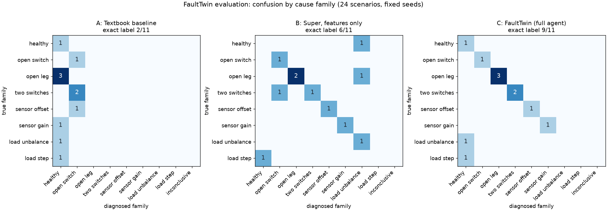

# FaultTwin evaluation results

11 scenarios with fixed seeds (development), run on 2026-10-21. Models: triage `nvidia/Nemotron-3_5-Lightning`, agent `nvidia/nemotron-3-super-120b-a12b`, work order `nvidia/Nemotron-3-Ultra-550b-a55b` (hedged by Super), all on Nebius Token Factory; web evidence through Tavily. Every run is reported, failures included.

**Methods.** A: textbook threshold detector (largest |μ| above 0.10 picks the leg, its sign the switch). B: Nemotron 3 Super given only the edge monitor's features, no tools. C: the full FaultTwin pipeline as the app runs it: the edge monitor must raise a medium or high alarm, then Lightning triage, the Super agent with the digital twin, the active test, Tavily and the safety interlock. When the monitor raises no alarm, C reports "healthy" and spends nothing (that is a correct outcome for a healthy converter, and counts as a wrong exact label for a look-alike).

## Summary

| Method | Exact label | Converter fault or not | False alarms on non-faults | Missed faults | Inconclusive |
|---|---|---|---|---|---|
| A. Textbook baseline | 2/11 (18 %) | 7/11 (64 %) | 1/5 | 3/6 | 0 |
| B. Super, features only | 6/11 (55 %) | 10/11 (91 %) | 0/5 | 1/6 | 0 |
| C. FaultTwin (full agent) | 9/11 (82 %) | 11/11 (100 %) | 0/5 | 0/6 | 0 |

Missed faults include inconclusive answers on a fault.

## Cost and time

- C (full agent, 8 diagnoses after an alarm): median $0.0204 per diagnosis including the work order (max $0.02497), median 35.95 s wall-clock (max 65.12 s), median 50653.0 tokens.
- Simulated time: the alarm came a median 0.0 fundamental cycles after the condition was applied; the diagnosis ended a median 8.5 cycles after it (20 ms per cycle; the agent's tools advance the plant for steady windows and the active test).
- B: median $0.0004 and 2.35 s per call.
- Total: B $0.0055, C $0.1557, C-T $0.0124.

## By scenario group

| Group | n | A exact | B exact | C exact | C fault-or-not |
|---|---|---|---|---|---|
| Single switch, low load (m = 0.35) | 1 | 1 | 1 | 1 | 1 |
| Whole leg | 3 | 0 | 2 | 3 | 3 |
| Two switches, different legs | 2 | 0 | 1 | 2 | 2 |
| Sensor offset | 1 | 0 | 1 | 1 | 1 |
| Sensor gain | 1 | 0 | 0 | 1 | 1 |
| Load unbalance | 1 | 0 | 1 | 0 | 1 |
| Load step (healthy converter) | 1 | 0 | 0 | 0 | 1 |
| Healthy, low load (m = 0.3) | 1 | 1 | 0 | 1 | 1 |

## Every scenario

| Scenario | Truth | Monitor alarm | A | B | C | C cost | C time | Notes |
|---|---|---|---|---|---|---|---|---|
| AL_open_low_load | AL_open | amplitude_ratio (medium) | AL_open ✓ | AL_open ✓ | AL_open ✓ | $0.0185 | 29.94 s | m-test refused by the interlock |
| leg_A_open | leg_A_open | amplitude_ratio (medium) | healthy ✗ | leg_A_open ✓ | leg_A_open ✓ | $0.0250 | 41.46 s |  |
| leg_B_open | leg_B_open | amplitude_ratio (medium) | healthy ✗ | load_unbalance_B ✗ | leg_B_open ✓ | $0.0236 | 44.79 s |  |
| leg_C_open | leg_C_open | amplitude_ratio (medium) | healthy ✗ | leg_C_open ✓ | leg_C_open ✓ | $0.0172 | 24.52 s |  |
| AU_BU_open | AU_BU_open | amplitude_ratio (medium) | CL_open ✗ | AU_BU_open ✓ | AU_BU_open ✓ | $0.0226 | 65.12 s | m-test: switch_fault |
| AL_CL_open | AL_CL_open | mean_current (high) | BU_open ✗ | BU_open ✗ | AL_CL_open ✓ | $0.0222 | 46.58 s | m-test: switch_fault |
| sensor_offset_B_minus_3A | sensor_offset_B | kcl_dc (medium) | BU_open ✗ | sensor_offset_B ✓ | sensor_offset_B ✓ | $0.0107 | 20.84 s | m-test: sensor_offset |
| sensor_gain_C_0.82 | sensor_gain_C | kcl_w1 (medium) | healthy ✗ | sensor_gain_A ✗ | sensor_gain_C ✓ | $0.0159 | 30.44 s |  |
| load_unbalance_B_0.75 | load_unbalance_B | none | healthy ✗ | load_unbalance_B ✓ | healthy ✗ | $0.0000 | 0 s | no alarm, no diagnosis |
| load_step_0.75 | load_step | none | healthy ✗ | healthy ✗ | healthy ✗ | $0.0000 | 0 s | no alarm, no diagnosis |
| healthy_low_load_1 | healthy | none | healthy ✓ | load_unbalance_A ✗ | healthy ✓ | $0.0000 | 0 s | no alarm, no diagnosis |

## What Tavily adds (C vs C-T, the 8 single-switch faults)

C-T is the same agent on the same plant data with the web tools removed.

| Scenario | C label | C-T label | C derate | C-T derate | C sources | C-T sources |
|---|---|---|---|---|---|---|
| AL_open_low_load | AL_open | AL_open | m = 0.35 (datasheet I_C,nom) | m = 0.35 (default (no datasheet)) | 2 | 0 |

- Derate limit from the verified datasheet rating: C 1/1, C-T 0/1.
- Diagnoses with at least one source URL: C 1/1, C-T 0/1.
- Exact label: C 1/1, C-T 1/1.

### The twin with the datasheet's device drops

A separate run per scenario on a plant whose IGBTs and diodes drop V_CE(sat) = 1.95 V and V_F = 1.85 V (the datasheet's typical values, read through Tavily from https://www.st.com/resource/en/datasheet/a1p50s65m2.pdf; assumption: the simulated devices match their datasheet). The twin without the datasheet ignores the drops; with it, it models them. No model calls.

| Scenario | Truth's match error without | with datasheet | Rank without | Rank with |
|---|---|---|---|---|
| AL_open_low_load | 5.759 % | 3.92 % | 1 | 1 |

## Confusion matrix

## Limitations

- 24 scenarios, one seed each: the numbers show behaviour, not statistically tight rates.
- The plant is a switching-cycle-average simulation with ±5 % R/L mismatch and 0.5 % noise; no hardware.
- The edge monitor does not alarm on a load unbalance or a load step by design (not a converter fault), so the full pipeline cannot name those look-alikes; it does not raise false alarms on them either.
- The two-switch causes are tested only when the agent asks for them (it is told to test the other 20 causes first); the safety interlock's own twin ranking always covers all 32.
- Recorded replays in the app are selected correct runs; this page reports every evaluation run.
