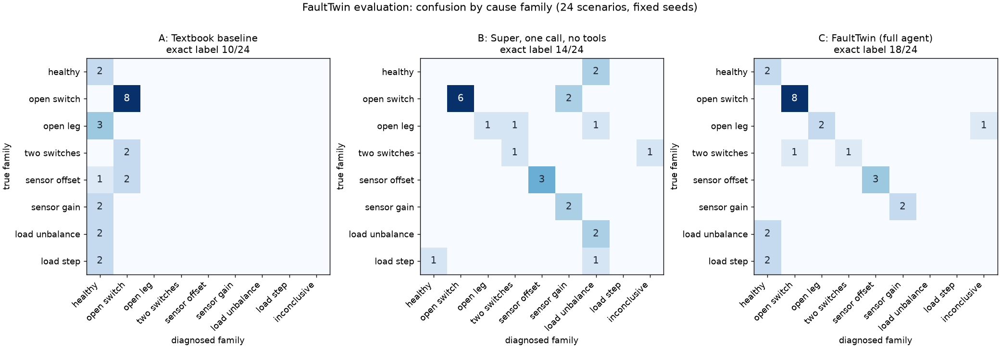

# FaultTwin evaluation results

24 scenarios with fixed evaluation seeds 8101-8124, one full run on 2026-10-21, 20:53-21:12 UTC. Models: triage `nvidia/Nemotron-3_5-Lightning`, agent `nvidia/nemotron-3-super-120b-a12b`, work order `nvidia/Nemotron-3-Ultra-550b-a55b` (hedged by Super, as in the app), all on Nebius Token Factory; web evidence through Tavily. Every run is reported, failures included.

**Methods.** A: textbook threshold detector (largest |μ| above 0.10 picks the leg, its sign the switch). B: Nemotron 3 Super in one call, given the edge monitor's features, its alarm message, the operating point and the same fault-signature notes as the agent; no tools. B runs on every scenario; if it were only asked after an alarm, like C, its exact label would be right in 15/24. C: the app's diagnosis pipeline (the edge monitor must raise a medium or high alarm, then Lightning triage, the Super agent with the digital twin, the active test, Tavily and the safety interlock, and the work order); in the evaluation the plant is paused while the models run. When the monitor raises no alarm, C reports "healthy" and spends nothing (a correct outcome for a healthy converter, a wrong exact label for a look-alike).

## Summary

| Method | Exact label | Converter fault or not | False alarms on non-faults | Missed faults | Inconclusive |
|---|---|---|---|---|---|
| A. Textbook baseline | 10/24 (42 %) | 19/24 (79 %) | 2/11 | 3/13 | 0 |
| B. Super, one call, no tools | 14/24 (58 %) | 20/24 (83 %) | 0/11 | 4/13 | 1 |
| C. FaultTwin (full agent) | 18/24 (75 %) | 23/24 (96 %) | 0/11 | 1/13 | 1 |

Missed faults include inconclusive answers on a fault. On the 18 scenarios where the edge monitor raised an alarm, the full agent's exact label was right in 16.

## Cost and time

- C (full agent, 18 diagnoses after an alarm): median $0.0177 of Token Factory cost per diagnosis, work order included (max $0.0262), plus one live Tavily credit; median 45066 triage and agent tokens (the work order adds about 2,000).
- Time to diagnosis: median 34.69 s wall-clock from the alarm to the checked answer and its work order (max 94.65 s: in leg_B_open a last model turn started 0.5 s before the 90 s budget ran out and got the 5 s minimum timeout; a turn now needs 8 s of budget left).
- Simulated time: the alarm came in the first cycle after the condition was applied (median). The agent's tools then advanced the plant by a median 10 cycles (steady windows, the active test); the plant is paused while the models think, so this is not a time to diagnosis.
- B: median $0.0005 and 3.365 s per call.
- Total: B $0.0124, C $0.3212, C-T $0.0866.

## By scenario group

| Group | n | A exact | B exact | C exact | C fault-or-not |
|---|---|---|---|---|---|
| Single switch, nominal load | 6 | 6 | 4 | 6 | 6 |
| Single switch, low load (m = 0.35) | 2 | 2 | 2 | 2 | 2 |
| Whole leg | 3 | 0 | 1 | 2 | 2 |
| Two switches, different legs | 2 | 0 | 1 | 1 | 2 |
| Sensor offset | 3 | 0 | 3 | 3 | 3 |
| Sensor gain | 2 | 0 | 2 | 2 | 2 |
| Load unbalance | 2 | 0 | 1 | 0 | 2 |
| Load step (healthy converter) | 2 | 0 | 0 | 0 | 2 |
| Healthy, low load (m = 0.3) | 2 | 2 | 0 | 2 | 2 |

## Every scenario

| Scenario | Truth | Monitor alarm | A | B | C | C cost | C time | Notes |
|---|---|---|---|---|---|---|---|---|
| AU_open | AU_open | amplitude_ratio (medium) | AU_open ✓ | AU_open ✓ | AU_open ✓ | $0.0206 | 27.6 s | m-test: switch_fault |
| AL_open | AL_open | amplitude_ratio (medium) | AL_open ✓ | sensor_gain_A ✗ | AL_open ✓ | $0.0208 | 35.88 s | m-test: switch_fault |
| BU_open | BU_open | amplitude_ratio (medium) | BU_open ✓ | BU_open ✓ | BU_open ✓ | $0.0184 | 31.69 s | m-test: switch_fault |
| BL_open | BL_open | amplitude_ratio (medium) | BL_open ✓ | sensor_gain_B ✗ | BL_open ✓ | $0.0176 | 29.58 s | m-test: switch_fault |
| CU_open | CU_open | amplitude_ratio (medium) | CU_open ✓ | CU_open ✓ | CU_open ✓ | $0.0174 | 27.72 s | m-test: switch_fault |
| CL_open | CL_open | amplitude_ratio (medium) | CL_open ✓ | CL_open ✓ | CL_open ✓ | $0.0247 | 38.26 s | m-test: switch_fault |
| AL_open_low_load | AL_open | amplitude_ratio (medium) | AL_open ✓ | AL_open ✓ | AL_open ✓ | $0.0239 | 62.66 s | m-test refused by the interlock |
| CU_open_low_load | CU_open | amplitude_ratio (medium) | CU_open ✓ | CU_open ✓ | CU_open ✓ | $0.0176 | 73.81 s | m-test refused by the interlock |
| leg_A_open | leg_A_open | amplitude_ratio (medium) | healthy ✗ | load_unbalance_A ✗ | leg_A_open ✓ | $0.0236 | 83.52 s | m-test: not informative (no significant mean current) |
| leg_B_open | leg_B_open | amplitude_ratio (medium) | healthy ✗ | leg_B_open ✓ | inconclusive ✗ | $0.0178 | 94.65 s | stopped: model call failed: APITimeoutError: Request timed out.; m-test: not informative (no significant mean current) |
| leg_C_open | leg_C_open | amplitude_ratio (medium) | healthy ✗ | BL_CL_open ✗ | leg_C_open ✓ | $0.0167 | 66.62 s |  |
| AU_BU_open | AU_BU_open | mean_current (high) | CL_open ✗ | AU_BU_open ✓ | AU_BU_open ✓ | $0.0262 | 86.5 s | m-test: switch_fault |
| AL_CL_open | AL_CL_open | mean_current (high) | BU_open ✗ | inconclusive ✗ | BU_open ✗ | $0.0234 | 33.5 s | m-test: switch_fault |
| sensor_offset_A_plus_1.5A | sensor_offset_A | kcl_dc (medium) | healthy ✗ | sensor_offset_A ✓ | sensor_offset_A ✓ | $0.0124 | 32.16 s | m-test: sensor_offset |
| sensor_offset_B_minus_3A | sensor_offset_B | kcl_dc (medium) | BU_open ✗ | sensor_offset_B ✓ | sensor_offset_B ✓ | $0.0127 | 25.81 s | m-test: sensor_offset |
| sensor_offset_C_plus_3A | sensor_offset_C | kcl_dc (medium) | CL_open ✗ | sensor_offset_C ✓ | sensor_offset_C ✓ | $0.0098 | 23.0 s | m-test: sensor_offset |
| sensor_gain_B_1.12 | sensor_gain_B | kcl_w1 (medium) | healthy ✗ | sensor_gain_B ✓ | sensor_gain_B ✓ | $0.0103 | 39.67 s |  |
| sensor_gain_C_0.82 | sensor_gain_C | kcl_w1 (medium) | healthy ✗ | sensor_gain_C ✓ | sensor_gain_C ✓ | $0.0074 | 22.01 s |  |
| load_unbalance_B_0.75 | load_unbalance_B | none | healthy ✗ | load_unbalance_B ✓ | healthy ✗ | $0.0000 | 0 s | no alarm, no diagnosis |
| load_unbalance_C_1.25 | load_unbalance_C | none | healthy ✗ | load_unbalance_A ✗ | healthy ✗ | $0.0000 | 0 s | no alarm, no diagnosis |
| load_step_1.3 | load_step | none | healthy ✗ | healthy ✗ | healthy ✗ | $0.0000 | 0 s | no alarm, no diagnosis |
| load_step_0.75 | load_step | none | healthy ✗ | load_unbalance_A ✗ | healthy ✗ | $0.0000 | 0 s | no alarm, no diagnosis |
| healthy_low_load_1 | healthy | none | healthy ✓ | load_unbalance_A ✗ | healthy ✓ | $0.0000 | 0 s | no alarm, no diagnosis |
| healthy_low_load_2 | healthy | none | healthy ✓ | load_unbalance_A ✗ | healthy ✓ | $0.0000 | 0 s | no alarm, no diagnosis |

## What Tavily adds (C vs C-T, the 8 single-switch faults)

C-T is the same agent on the same plant data with the web tools removed.

| Scenario | C label | C-T label | C derate | C-T derate | C sources | C-T sources |
|---|---|---|---|---|---|---|
| AU_open | AU_open | AU_open | m = 0.66 (limit from datasheet I_C,nom) | m = 0.4 (conservative default, no datasheet) | 2 | 0 |
| AL_open | AL_open | AL_open | m = 0.66 (limit from datasheet I_C,nom) | m = 0.4 (conservative default, no datasheet) | 5 | 0 |
| BU_open | BU_open | BU_open | m = 0.66 (limit from datasheet I_C,nom) | m = 0.4 (conservative default, no datasheet) | 5 | 0 |
| BL_open | BL_open | BL_open | m = 0.66 (limit from datasheet I_C,nom) | m = 0.4 (conservative default, no datasheet) | 5 | 0 |
| CU_open | CU_open | CU_open | m = 0.66 (limit from datasheet I_C,nom) | m = 0.4 (conservative default, no datasheet) | 5 | 0 |
| CL_open | CL_open | CL_open | m = 0.66 (limit from datasheet I_C,nom) | m = 0.4 (conservative default, no datasheet) | 2 | 0 |
| AL_open_low_load | AL_open | AL_open | not needed (m stays 0.35) | not needed (m stays 0.35) | 5 | 0 |
| CU_open_low_load | CU_open | CU_open | not needed (m stays 0.35) | not needed (m stays 0.35) | 5 | 0 |

- The verified datasheet rating changed the interlock's derate in 6/8 runs (at nominal load the derated drive kept m = 0.66 instead of the conservative default 0.40, i.e. more output while still under 50 % of I_C,nom); in 2/8 (low load) no derate was needed either way. The datasheet came from a Tavily extract cached on 2026-10-21; each diagnosis made one live Tavily search (failure evidence).
- Diagnoses with at least one source URL: C 8/8, C-T 0/8 (C-T has no web tools, so 0 is expected by design).
- Exact label: C 8/8, C-T 8/8: Tavily did not change the labels.
- Token Factory cost on these runs: $0.1608 with the web tools, $0.0866 without.

### The twin with the datasheet's device drops

A separate run per scenario on a plant whose IGBTs and diodes drop V_CE(sat) = 1.95 V and V_F = 1.85 V (the datasheet's typical values, read through Tavily from https://www.st.com/resource/en/datasheet/a1p50s65m2.pdf; assumption: the simulated devices match their datasheet). The twin without the datasheet ignores the drops; with it, it models them. No model calls. The window starts 10 cycles after the alarm, so it holds no fault-onset transient (a first version took the window right after the alarm; it also gave 4 down and 4 up).

| Scenario | Truth's match error without | with datasheet | Rank without | Rank with |
|---|---|---|---|---|
| AU_open | 2.156 % | 2.29 % | 1 | 1 |
| AL_open | 3.222 % | 2.938 % | 1 | 1 |
| BU_open | 1.737 % | 2.579 % | 1 | 1 |
| BL_open | 2.76 % | 3.15 % | 1 | 1 |
| CU_open | 2.84 % | 2.359 % | 1 | 1 |
| CL_open | 1.97 % | 2.498 % | 1 | 1 |
| AL_open_low_load | 5.339 % | 3.128 % | 1 | 1 |
| CU_open_low_load | 3.883 % | 3.818 % | 1 | 1 |

With the datasheet's drops the true cause's match error went down in 4 of 8 scenarios and up in 4 (mean change -0.14 points); the true cause ranked first either way.

Check on an ideal plant (no noise, no R/L tolerance, the same drops): the truth's match error is 1.85 % on average without the datasheet and at most 0.000 % with it, so the drops are modelled correctly; on the realistic plant their effect (about 2 V on a 400 V DC link) is smaller than that of the ±5 % R/L tolerance and the noise.

## What this run showed, and what changed afterwards

The tables above are the first and only full run, unchanged. Two of the full agent's answers were wrong for reasons
the evaluation exposed in the design. Both were fixed after the run and checked on development seeds (6700 + n) only;
the evaluation seeds were not run again. Any later full run must use fresh seeds (for example 8201-8224), because
these failures guided the fixes, and it will be reported next to this one. To reproduce these numbers, apply
`eval/results/pre_fix_agent.patch`, which removes the post-run changes from the agent (the report code changed
afterwards only in wording and in the device-drop experiment's window, which makes no model calls).

1. **AL_CL_open was called BU_open.** The agent tested only the 20 default causes; the two-switch causes are tested
   only when asked for. Its best tested cause, BU_open, had a match error of 107 %, so it explained nothing, and no
   check looked at the size of the error. The safety interlock's own ranking of all 32 causes, computed for its derate
   decision, had AL_CL_open first and derated for it. Fix: the twin tool now reports an untested cause that
   matches far better, and the final-answer check sends back an answer whose best match is above 25 % or more than
   twice the error of the interlock's best. On the development seed the agent then tested all 32 causes and found
   AL_CL_open (3.1 %).
2. **leg_B_open ended inconclusive.** The twin had leg_B_open first (6.2 %). The agent also ran the modulation test,
   which cannot decide for an open leg (there is no mean current to compare). Its first answer drew a conclusion from
   that test and was sent back. Its second answer said the test could not separate the causes, but the check matched an
   outcome word elsewhere in the answer and sent it back again (a false positive). The third model turn started 0.5 s
   before the 90 s budget ran out, got the client's 5 s minimum timeout and timed out: our own time budget, not a
   Token Factory outage. Fixes: wording problems are sent back once, then code removes the sentences concerned; the
   test check now works sentence by sentence; and a model turn is started only with at least 8 s of budget left. On
   the development seeds leg_B_open and leg_C_open were then diagnosed correctly.

Other results, stated plainly:

- **No alarm.** The edge monitor raised no medium or high alarm for the two load unbalances (±25 % on one phase), the
  two load steps and the two healthy low-load cases (load_step_0.75 logged one low-severity transient). The pipeline
  therefore reported "healthy" for all six: correct for the healthy converter and no false alarm on the look-alikes,
  but no exact label for them. Larger single-phase unbalances (beyond about ±35-50 %) do raise an alarm.
- **The textbook baseline's two false alarms** were the 3 A sensor offsets, called BU_open and CL_open because a 3 A
  offset puts |μ| above its 0.10 threshold. FaultTwin's KCL residual and modulation test (μ ratio 1.59 and 1.60, where
  an offset predicts 1.60 and a switch fault 1.0) identified both as sensor offsets. The 1.5 A offset and the two gain
  errors the baseline called healthy (misses, not false alarms). It also cannot see an open leg: μ stays near 0, and it
  called all three healthy.
- **Super in one call** named all 5 sensor errors and raised no false alarm. It missed 4 of the 13 faults (AL_open and
  BL_open called sensor gain errors, leg A a load unbalance, AL_CL_open inconclusive), called open leg C a two-switch
  fault, and called both healthy low-load cases load unbalances.
- **Triage.** Lightning named the right family in 17 of the 18 alarmed runs; it called the -3 A offset on phase B a
  switch or leg fault although the code-evaluated rule for a KCL residual held. The agent was not misled, because the
  twin and the modulation test decide.
- **What Tavily changed.** With Tavily the interlock's current limit came from the verified datasheet rating
  (I_C,nom = 50 A, from a Tavily extract cached on 2026-10-21) in all 8 single-switch runs; without it the interlock
  used its conservative default. That changed the derate in 6 of 8 runs (m = 0.66 instead of 0.40 at nominal load); at
  low load no derate was needed either way. Every diagnosis with Tavily cited sources; the labels were the same
  without it. Tavily changes the safety limits and the evidence, not the label.
- **The datasheet's device drops did not improve the twin.** On a plant that drops the datasheet's V_CE(sat) and V_F,
  the true cause's match error went down in 4 of 8 scenarios and up in 4, with a window 10 cycles after the alarm (a
  first version right after the alarm gave the same split). On an ideal plant the drops are matched exactly, so they
  are modelled correctly; on the realistic plant they (about 2 V on a 400 V DC link) are small against the ±5 % R/L
  tolerance and the noise.
- **Low load.** At m = 0.35 a modulation step cannot go down (steps of at least 0.15, and m may not fall below 0.3),
  and the interlock refused the agent's request to raise m to 0.50 because a converter fault was plausible. Both
  low-load faults were diagnosed from the twin alone, both correctly. (This waiver and the reading of datasheet Typ
  values were added before the full run, after the first development run.)

## Confusion matrix

## Limitations

- 24 scenarios, one seed each: the numbers show behaviour, not statistically tight rates.
- The plant is a switching-cycle-average simulation with ±5 % R/L mismatch and 0.5 % noise; no hardware.
- The edge monitor raised no medium or high alarm for these load unbalances (±25 % on one phase) or load steps, so the full pipeline did not diagnose them (and raised no false alarm). Its amplitude-ratio band [0.90, 1.10] is crossed only beyond about ±35-50 % on one phase; larger unbalances do raise an alarm.
- The look-alike sizes were chosen within the ranges planned before the run (sensor offsets 1-3 A, gains 0.8-0.9 or 1.1-1.2, one-phase R factor 0.7-1.3, load steps ±30 %), except the second load step (-25 % instead of -30 %). The baseline's false alarms depend on the offset size: at m = 0.8 its 0.10 threshold on μ is about 2.7 A, so only the 3 A offsets fooled it.
- The two-switch causes are tested only when the agent asks for them (it is told to test the other 20 causes first); the safety interlock's own twin ranking always covers all 32.
- Recorded replays in the app are selected correct runs; this page reports every evaluation run.
